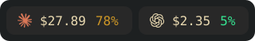

<h1 align="center">burnrate</h1>

<p align="center">
  Track <b>Claude Code</b> and <b>Codex</b> usage from your status bar.<br>
  Today's estimated cost, quota usage and recent history, always visible.
</p>

<p align="center">
  <a href="https://github.com/goromlagche/burnrate/releases"></a>
  <a href="https://pkg.go.dev/github.com/goromlagche/burnrate"></a>
  <a href="LICENSE"></a>
</p>

<table align="center">
  <tr>
    <td align="center">
      <br>
      <sub>Linux · Waybar</sub>
    </td>
    <td align="center">
      <br>
      <sub>macOS · menu bar</sub>
    </td>
  </tr>
</table>

## Install

Requires Go 1.22 or later.

**Linux**

```sh
go install github.com/goromlagche/burnrate@v0.1.3
burnrate install
```

- Starts a systemd user timer. It runs every minute.
- Add the modules from [`contrib/waybar/config.jsonc`](contrib/waybar/config.jsonc) to Waybar.
- The icons need a [Nerd Font](https://www.nerdfonts.com/).

<details>
<summary>i3status instead of Waybar</summary>

Set `markup = "pango"` in `general`. Add `read_file` blocks for `~/.cache/burnrate/claude.txt` and `codex.txt`, with absolute paths.

</details>

**macOS**

```sh
xcode-select --install   # once, to build the menu bar app
go install github.com/goromlagche/burnrate@v0.1.3
burnrate install
```

- Builds a native menu bar app. It starts at login.
- On the first run, allow access to the `Claude Code-credentials` Keychain item.

Remove it with `burnrate uninstall`.

> **Using a coding agent?** Tell it: *"Install burnrate from github.com/goromlagche/burnrate."* It follows [`AGENTS.md`](AGENTS.md).

## What you see

- **Today's cost**, estimated at API list prices. It is not your bill.
- **Quota used (%)**: Claude's monthly cap, and Codex's monthly workspace credits. Codex falls back to the weekly limit.
- **History** on hover or click: the last 7 days and the month total.

## Privacy and how it works

Reads local Claude Code and Codex logs incrementally. Deduplicates responses across resumed and forked sessions. Prices are in [`pricing.go`](pricing.go). Output stays in `~/.cache/burnrate/`, readable only by you.

<details>
<summary>Usage API details</summary>

Every 5 minutes, burnrate sends two read-only requests with the logins you already have:

- `api.anthropic.com/api/oauth/usage`, the endpoint that Claude Code's `/usage` uses
- `chatgpt.com/backend-api/wham/usage`, the endpoint that Codex's `/status` uses

It never refreshes, stores or logs the tokens. Both endpoints are undocumented and can change.

</details>

## Optional configuration

`~/.config/burnrate/config.json`:

```json
{ "codex_credit_usd": 0.05 }
```

Codex reports credits, not dollars. Set the price of one credit to see the cap in dollars. `0.05` is an example; use your own price.

## Development

```sh
make test
make install
```

---

<sub>Deduplication follows <a href="https://github.com/pingdotgg/t3code">T3 Code</a> and <a href="https://github.com/stablyai/orca">Orca</a>. Icons from <a href="https://www.nerdfonts.com/">Nerd Fonts</a>. Claude, Codex and OpenAI are trademarks of their owners. Not affiliated with Anthropic or OpenAI. MIT license.</sub>
